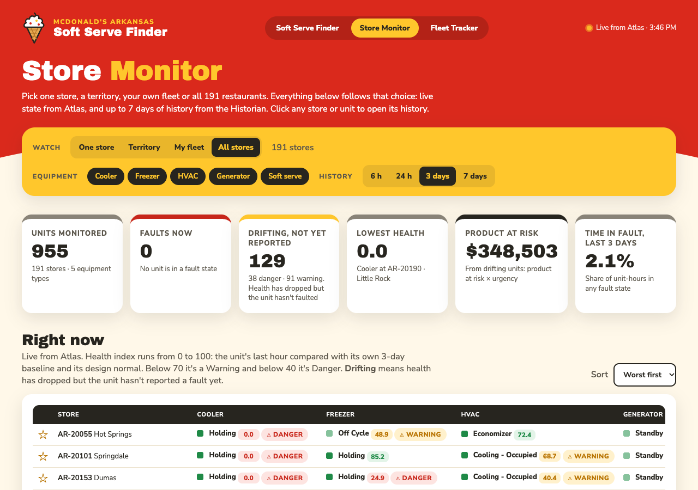
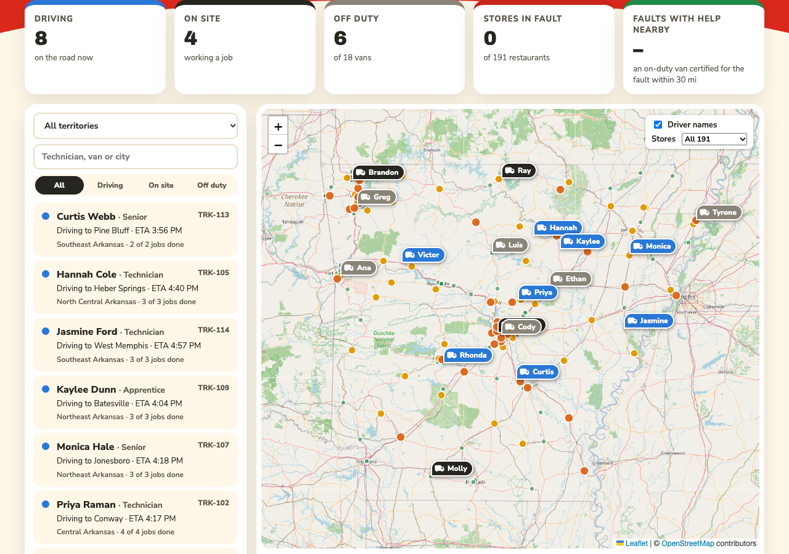
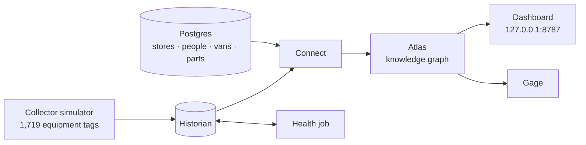

# McDonald's Arkansas: a Timebase field-service demo

A working model of restaurant equipment maintenance across 191 McDonald's locations in Arkansas, built on the
**Timebase** industrial data platform (Collector, Historian, Connect, Atlas and Gage).

It brings live equipment readings together with technicians, certifications, service vans, parts and road distances
in one knowledge graph, so it can answer, in one query: *which equipment is about to fail, what is at stake, and who
can fix it on their way past today?* And: *is the ice cream machine broken?*

Store locations are real public addresses. Everything else (equipment data, people, vans, routes) is simulated, and
the demo keeps itself current: open it on any day and the same stories are there.

## Start here

| If you want to… | Read |
|---|---|
| Understand what this is and how the pieces fit | [docs/OVERVIEW.md](docs/OVERVIEW.md) |
| Give the demo | [docs/DEMO_SCRIPT.md](docs/DEMO_SCRIPT.md) |
| Understand the data: tables, Atlas types, terms | [docs/DATA_MODEL.md](docs/DATA_MODEL.md) |
| Run it, or set it up on another machine | [docs/SETUP.md](docs/SETUP.md) |
| Know where the equipment data comes from | [simulator/README.md](simulator/README.md) |
| Maintain it: build details, formulas, Atlas quirks | [docs/REFERENCE.md](docs/REFERENCE.md) |

## At a glance

- **Dashboard:** http://127.0.0.1:8787, with three tabs: Soft Serve Finder, Store Monitor and Fleet Tracker.
- **Rebuild the database:** `./build.sh` (all 67 checks must say PASS).
- **Simulator config:** `tools/simulator_config.py diff` checks the repo copy against the live Collector.

## Repo layout

| Folder | Contents |
|---|---|
| `docs/` | The documents above |
| `simulator/` | Data Collector simulator config |
| `sql/` | Numbered Postgres build scripts and verification checks |
| `atlas/` | Atlas library, domain, instance maps, demo queries and the Gage skill |
| `dashboard/` | The web dashboard |
| `tools/` | Setup and maintenance scripts |
| `launchd/` | macOS background jobs |
| `seed/` | Source data for stores and ZIP codes |
