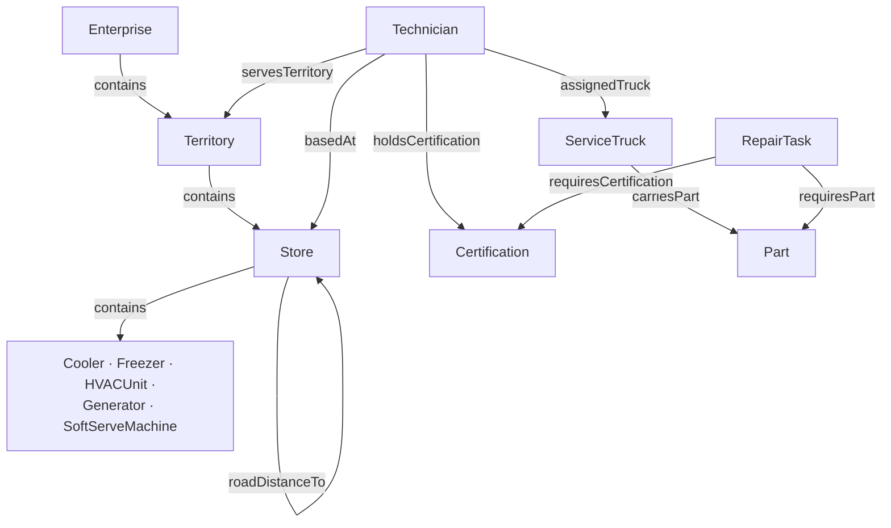

# Data model

Three layers hold the data. Each has one job.

| Layer | Holds | Changes |
|---|---|---|
| **Historian** (dataset `McDonalds`) | Equipment readings over time, plus the health job's averages, baselines and uptime figures | Every few seconds (simulator) and every 5 minutes (health job) |
| **Postgres** (`mcdonalds_ar`) | Business records: stores, people, vans, certifications, parts, inventory, distances, route plans | Rarely; inventory once a day |
| **Atlas** (domain `mcdonalds-ops`) | The connected model: every store, unit, technician and van as a node, with relationships and live calculated values | Recompiled daily; live values stream in |

## Postgres

Database `mcdonalds_ar`. Connect reads only the `api` views, as the read-only user `mcd_reader`.

### Schemas and tables

| Schema | Tables | What they are |
|---|---|---|
| `org` | `territory`, `store` | 6 territories, 191 restaurants (real Arkansas addresses, coordinates, hours, drive-thru, etc.) |
| `hr` | `technician`, `technician_certification` | 18 technicians (3 per territory: Senior, Technician, Apprentice) and the certificates they hold |
| `fleet` | `truck`, `truck_assignment`, `truck_par_level`, `truck_inventory_daily`, `route_setting`, `route_stop`, `route_leg` | 18 service vans, who drives which, how many of each part a van should carry (par), the daily stock count, and the 21-day route plan with road geometry |
| `geo` | `store_distance`, `zip_code` | Road miles and drive minutes between nearby stores; ZIP code centroids for the Finder search |
| `ref` | `certification`, `cert_level`, `equipment_class`, `part`, `repair_task`, `repair_task_certification`, `repair_task_part`, `health_band`, `county`, `location_type`, `operating_status`, `truck_status`, `demo_setting` | Shared vocabularies and rules: what each repair needs, what each kind of equipment is worth, the demo anchor date |
| `util` | | Audit plumbing (triggers, the row-version sequence) |
| `api` | 20 views (`v_store`, `v_technician`, `v_truck_inventory_current`, `v_truck_position_live`, …) | What Connect polls. Nothing reads the base tables directly. |

Every table has `created_utc`, `modified_utc`, `is_deleted`, `deleted_utc` and `row_version`. `row_version` comes from
one database-wide sequence and is what Connect uses to detect changes. Rows are never hard-deleted; they're marked
`is_deleted`.

### The reference rules

**Equipment classes** (`ref.equipment_class`):

| Class | Design normal | Tolerance | Product at risk | Max detour |
|---|---|---|---|---|
| Walk-in Cooler | 38 °F | 1 | $3,500 | 30 mi |
| Walk-in Freezer | −4 °F | 2 | $6,000 | 40 mi |
| Rooftop HVAC | 58 °F supply air | 3 | $800 | 15 mi |
| Backup Generator | 70 % load | 6 | $300 | 5 mi |
| Soft Serve Machine | n/a (state only) | | $400 | 10 mi |

**Certifications** (`ref.certification`): EPA608 (EPA Section 608 Universal), REFRIG (Commercial Refrigeration, RSES),
HVAC (Air Conditioning, NATE), GEN (Standby Generator, Generac), TAYLOR (Soft Serve Equipment, Taylor).

**Repair tasks** (`ref.repair_task`): two per equipment class (one for Warning, one for Danger) plus one for a broken ice
cream machine. Each needs a minimum technician level, zero or more certifications and a set of parts:

| Task | For | Level | Certifications | Parts |
|---|---|---|---|---|
| CLR-SEAL | Cooler, Warning | Apprentice | | coil cleaner, cooler gasket |
| CLR-EVAP | Cooler, Danger | Technician | EPA608, REFRIG | evaporator fan, R-404A |
| FRZ-DEFR | Freezer, Warning | Technician | REFRIG | defrost heater, defrost timer |
| FRZ-COMP | Freezer, Danger | Senior | EPA608, REFRIG | contactor, R-404A, start capacitor |
| HVAC-AIR | HVAC, Warning | Apprentice | | filter, belt |
| HVAC-CAP | HVAC, Danger | Technician | EPA608, HVAC | R-410A, run capacitor |
| GEN-SVC | Generator, Warning | Technician | GEN | oil, battery |
| GEN-AVR | Generator, Danger | Senior | GEN | voltage regulator |
| TAY-TUNE | Soft serve, Fault | Apprentice | TAYLOR | scraper blade, Taylor kit |

### Things that are calculated, not stored

- **Van positions.** `fleet.truck_position_at(time)` works out where every van is from the route plan and the clock.
  `api.v_truck_position_live` is "now"; `api.v_truck_track_recent` is the last 7 days.
- **Certification dates.** `api.v_technician_certification_live` shifts every date forward by the days since the demo
  anchor (`ref.demo_setting`, 2026-11-01), so the stories don't drift.
- **Today's van inventory.** The health job adds each new day's count (`fleet.generate_inventory`).

## Historian tags

Tag names are `AR-<store number>.<Asset>.<Signal>`.

| From | Tags per unit |
|---|---|
| Simulator | `.State` and one measurement: `Cooler.Temperature`, `Freezer.Temperature`, `HVAC.SupplyAirTemperature`, `Generator.LoadPercent`. Soft serve has only `.State`. |
| Health job | `<Signal>Avg1h` (last hour of steady running), `<Signal>BaselineMean`, `<Signal>BaselineStdDev`, `<Signal>BaselineMode`; for soft serve, `Uptime24h`, `Uptime7d`, `Serving7d`, `Failures7d`, `MtbfHours`, `MttrHours`, `DownMinutes`, `DownHours7d` |

State codes are listed in [`simulator/README.md`](../simulator/README.md#state-codes).

## Atlas

Library `mcdonalds` holds the types; domain `mcdonalds-ops` holds the instances. Copies of both are in `atlas/`.

### Things (entity types)

| Type | Count | Key values |
|---|---|---|
| Enterprise | 1 | |
| Territory | 6 | |
| Store | 191 | address, location, hours, features, `StoreHealthIndex` (worst unit) |
| Cooler, Freezer | 191 each | `Temperature`, `RefrigerationState`, `HealthIndex`, `ServiceCondition`, `DetourAllowanceMiles`, `ExposureUsd` |
| HVACUnit | 191 | `SupplyAirTemperature`, `HVACState`, plus the same health values |
| Generator | 191 | `LoadPercent`, `GeneratorState`, plus the same health values |
| SoftServeMachine | 191 | `SoftServeState`, uptime figures, `ReliabilityScore`, `ReliabilityGrade`, `LostSalesUsd7d`, `IsServing` |
| Technician | 18 | level, home store, hire date |
| ServiceTruck | 18 | make, model, plate, `GpsLatitude`, `GpsLongitude`, `TruckStatus`, `CurrentStoreId`, `NextStoreId` |
| Certification | 5 | |
| Part | 18 | part number, unit cost |
| RepairTask | 9 | symptom, minimum level, estimated minutes |

1,221 instances and about 19,700 relationships in total. Most relationships are `roadDistanceTo` (18,145 store pairs).

### Relationships carry data

Values that belong to a pairing live on the relationship itself:

- `holdsCertification`: certificate number, expiry date, whether it's current
- `carriesPart`: quantity on hand, par quantity, count date
- `requiresPart`: quantity
- `roadDistanceTo`: road miles, drive minutes
- `assignedTruck`: since when

### Calculations (Atlas functions)

| Function | Gives |
|---|---|
| `HealthIndexOf` | 0–100 health from the hourly average vs the unit's own baseline and vs design normal |
| `ClassifyHealth` | Healthy / Warning / Danger from the index |
| `ServiceConditionOf` | 0 Healthy, 1 Warning not yet noticed, 2 Danger not yet noticed, 3 Fault (the store already knows) |
| `DetourAllowanceMilesOf` / `ExposureUsdOf` | How far out of the way it's worth driving, and the dollars at risk, scaled by urgency |
| `WorstHealthIndex` | A store's index is its worst unit |
| `ReliabilityScoreOf` / `ReliabilityGradeOf` | Ice cream machine: 70 % 7-day uptime + 30 % 24-hour uptime, graded A–F |
| `LostSalesUsdOf` | Down hours × $42 |
| `IsServingOf`, `CustomerHearsBrokenOf` | Is it serving; would a customer be told "it's broken" (includes cleaning cycles) |

The demo's main query, `atlas/queries/detour_stops.cypher`, uses nearly all of this at once. The full formulas are in
[REFERENCE.md](REFERENCE.md).

## Glossary

| Term | Meaning |
|---|---|
| **Anchor date** | 2026-11-01, the "today" the seed data was written for. Stored in `ref.demo_setting`. Dates that must not drift are shifted by (today − anchor). |
| **At-risk unit** | A simulated unit that runs worse than design all the time and faults more often. 38 per equipment class, 95 unreliable ice cream machines. |
| **Avg1h** | The average of the last hour of *steady* running (e.g. Holding for a cooler), skipping defrost and door-open periods. |
| **Baseline** | A unit's own normal: mean and standard deviation of its hourly averages over 3 days. Falls back to the design normal when there isn't enough steady data. |
| **Design normal** | What a kind of equipment should run at (cooler 38 °F). From `ref.equipment_class`. |
| **Health index** | 0–100. 70+ Healthy, 40–70 Warning, under 40 Danger. |
| **Service condition** | Healthy, Warning undetected, Danger undetected, or Fault detected. |
| **Detour allowance** | The extra miles worth driving to fix a unit, from its product at risk and how urgent it is. |
| **Exposure** | Dollars of product at risk, scaled by urgency. |
| **Par level** | How many of a part a van should carry. |
| **STOP / NEAR MISS** | Detour query result: the technician can do the repair now / could, except for the missing level, certificates or parts listed. |
| **Rotation day** | Day 1–21 of the repeating van route plan, starting Monday 2026-11-02. |
| **Truck status** | 0 off duty, 10 driving, 20 on site, 30 lunch. |
| **Right to Repair** | The 2024 US Copyright Office exemption that lets anyone repair the machines. In the demo, a switch that lifts the Taylor certification requirement. |
| **TVQ** | Timestamp, Value, Quality: the shape of every live value in Atlas. |
