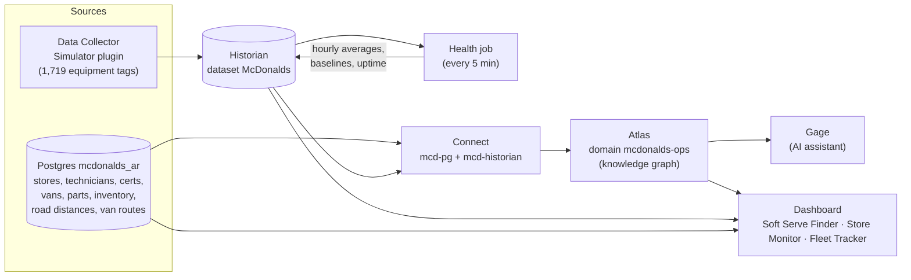

# What this demo is

A working model of McDonald's restaurant maintenance across Arkansas, built on the **Timebase** industrial data
platform. It answers the questions a field-service manager asks every morning:

- Which restaurants have equipment that is about to fail, and what is at stake if it does?
- Which of my technicians can fix it: are they certified, do they have the parts on the van, and how far away are they
  right now?
- Is a technician already driving past a store that needs them?

And, because everyone has a story about it: **is the ice cream machine broken?**

None of it uses real McDonald's data. The 191 restaurant locations are real Arkansas McDonald's addresses; the
equipment readings, technicians, vans, certifications and routes are simulated, and are built so the demo is always
current: open it on any day and the same stories are there.

## The business problem

A fast-food chain runs thousands of pieces of equipment that sit in different systems:

- **Equipment readings** (cooler temperatures, HVAC supply air, generator load, machine state) live in controllers
  and a historian.
- **People and assets** (technicians, their certifications, their vans, what parts each van carries) live in HR,
  fleet and inventory databases.
- **Locations and distances** live in yet another place.

A dispatcher who wants to know "who should go fix the freezer in West Memphis?" has to join all of these in their
head. Most chains only find out about a failing freezer when the store calls in, after the product is already lost.

The demo shows Timebase bringing those sources together into one model so the questions above can be answered in
one query, and the answers can be acted on before something breaks.

## The pieces

| Piece | What it does here |
|---|---|
| **Data Collector (Simulator)** | Plays the part of the restaurants' equipment controllers. Generates live readings for 5 kinds of equipment in all 191 stores. Some units are healthy, some are quietly going bad. See [`simulator/README.md`](../simulator/README.md). |
| **Historian** | Stores every reading as time-series data (dataset `McDonalds`). |
| **Postgres** | The "business systems": stores, territories, technicians, certifications, vans, parts, daily van inventory, store-to-store road distances and the vans' daily routes. |
| **Health job** | A small Python job (`tools/health_baseline.py`) that every 5 minutes works out each unit's recent average and its normal baseline, plus ice cream machine uptime, and writes them back to the Historian. |
| **Connect** | Feeds Atlas from both Postgres and the Historian. |
| **Atlas** | The knowledge graph. It knows that a technician *holds* a certification, *drives* a van that *carries* parts, and *is based at* a store that is *so many road miles from* another store, and it scores every unit's health. One query can walk all of that. |
| **Gage** | Timebase's AI assistant. It has a skill (`atlas/skills/`) that teaches it how to query this domain, so you can ask it questions in plain English. |
| **Dashboard** | A local web page (http://127.0.0.1:8787) with three tabs, reading Atlas, the Historian and Postgres. |

## The three dashboard tabs

1. **Soft Serve Finder.** "Is the ice cream machine broken?" Type a ZIP code to find the nearest working machine,
   see statewide reliability grades (A "Swirl Legend" to F "Certified Broken"), lost sales, and which technician could
   fix a broken machine. Includes the **Right to Repair** toggle.
2. **Store Monitor.** Watch one store, a territory or all of them: live equipment values, health index and up to 7
   days of history, unit by unit.
3. **Fleet Tracker.** All 18 technician vans on a map of Arkansas, moving on real roads through their day: who is
   driving, where they're headed, what they're certified for, and which faults have a certified van close by. Below
   the map, a matrix of every technician's certifications, with expiring and expired ones flagged.

## How it scores equipment health

Each refrigerated unit, HVAC unit and generator gets a **health index** from 0 to 100:

- Its last hour of steady running is compared with **its own normal** (the past 3 days) and with the **design normal**
  for that kind of equipment (a cooler should hold 38 °F).
- Whichever comparison is worse sets the score. 70+ Healthy, 40–70 Warning, under 40 Danger.
- The design check matters: a cooler that has *always* run at 41 °F looks normal against its own history, but it is
  not.

Atlas then gives each unit a **service condition**: Healthy, Warning (not yet noticed), Danger (not yet noticed), or
Fault (the store already knows). The value of the demo is in the middle two: problems found *before* anyone calls.

Each kind of equipment also has a **consequence**: a freezer holds about $6,000 of product, a cooler $3,500. That
sets how far out of their way a technician should drive for it (40 miles for a freezer, 5 for a generator).

## Why it is always demo-ready

Nothing has to be maintained by hand:

- The simulator runs continuously, so there is always live and historical data.
- Van positions are never stored; they are calculated from the clock and a 21-day route plan, so the vans are always
  somewhere sensible.
- Van parts inventory is counted daily by the health job.
- Certification dates roll forward with the calendar, so the same certificate is always 5 days from expiring and the
  same one is always lapsed.
- The health job recompiles Atlas once a day so it picks up the new dates and counts.

## Where to go next

- [Demo script](DEMO_SCRIPT.md): a 15-minute walkthrough of the stories.
- [Data model](DATA_MODEL.md): the database tables, the Atlas types and a glossary.
- [Setup](SETUP.md): how to run it on a new machine.
- [Reference](REFERENCE.md): build details, formulas and Atlas quirks for whoever maintains it.
